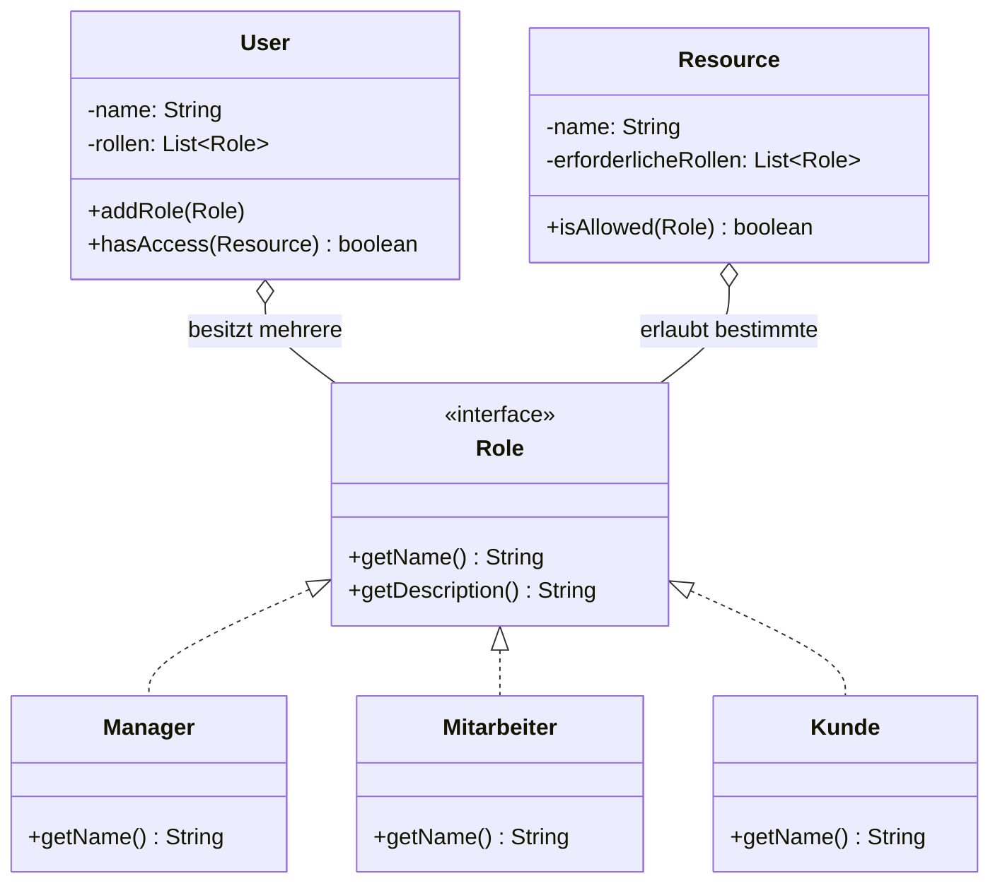

# 🔐 RBAC (Role-Based Access Control in Java)

Eine objektorientierte Implementierung des Sicherheitskonzepts **Role-Based Access Control (RBAC)** zur rollenbasierten Zugriffskontrolle auf geschützte Ressourcen.

Entwickelt im Rahmen des Gegenstands **Softwareentwicklung (SEW)** an der HTL TGM Wien (3. Jahrgang, 2. Semester).

---

## 🏛 Architektur & Sicherheitskonzept

Das System trennt Benutzeridentitäten (`User`), Rollenberechtigungen (`Role`) und geschützte Systemressourcen (`Resource`) nach dem Principle of Least Privilege:



- **`User`**: Repräsentiert einen Benutzer im System. Kann eine oder mehrere Rollen innehaben. Prüft über `hasAccess(Resource)`, ob mindestens eine seiner Rollen Zugriff auf die angeforderte Ressource hat.
- **`Role`**: Interface zur Abstraktion von Rollen (`Manager`, `Mitarbeiter`, `Kunde`).
- **`Resource`**: Repräsentiert geschützte Endpunkte, Daten oder Systembereiche, die an Rollenfreigaben gekoppelt sind.
- **`TestKlasse`**: Enthält Testfälle für Positiv- und Negativtests (z. B. Kunde darf keine Admin-Ressourcen abrufen; Manager hat Vollzugriff).

---

## ✨ Features

- **Multi-Role Support**: Benutzer können mehrere Rollen gleichzeitig zugewiesen bekommen.
- **Entkoppelte Rollenverwaltung**: Neue Rollen können ohne Änderung an der Kernlogik von `User` implementiert werden (Open-Closed Principle).
- **UML-Dokumentation**: Enthält ein Klassendiagramm als Astah-Datei (`rbac-TimonHollaus.asta`) und als Bild (`UML-Diagramm.png`).

---

## 📁 Projektstruktur

```
rbac-role-based-access-control/
├── README.md               # Projektdokumentation
├── .gitignore              # Git Ignore für Java/IDE
├── UML-Diagramm.png        # Visuelles UML-Klassendiagramm
├── rbac-TimonHollaus.asta  # Astah UML-Modelldatei
└── src/                    # Quellcode
    ├── User.java           # Benutzer mit Rollenverwaltung & hasAccess()
    ├── Role.java           # Rollen-Interface
    ├── Manager.java        # Rolle: Volle Zugriffsrechte
    ├── Mitarbeiter.java    # Rolle: Interne Unternehmensressourcen
    ├── Kunde.java          # Rolle: Eingeschränkte Kundenansicht
    ├── Resource.java       # Geschützte Ressource mit Berechtigungsprüfung
    └── TestKlasse.java     # Testfälle & Szenarien
```

---

## 🚀 Ausführung & Tests

```bash
# Kompilieren
javac -d out/production/src src/*.java

# Testsuite ausführen
java -cp out/production/src TestKlasse
```

---

## 👤 Autor

**Timon Hollaus**  
HTL TGM Wien – Abteilung für Informationstechnologie
